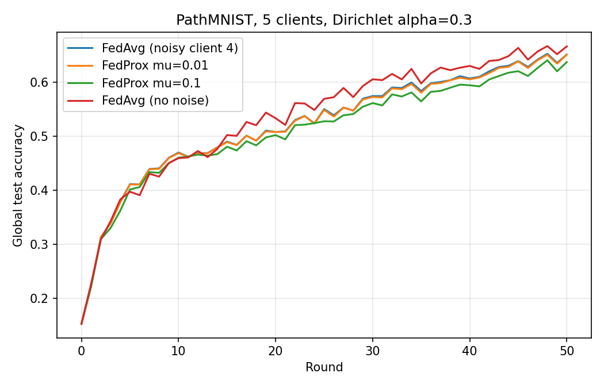
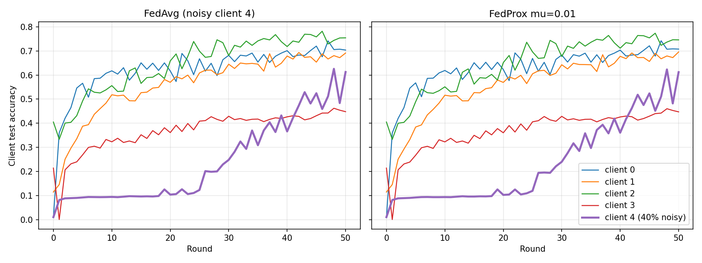
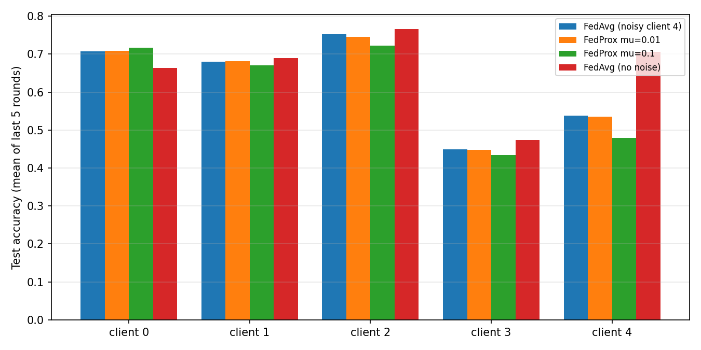
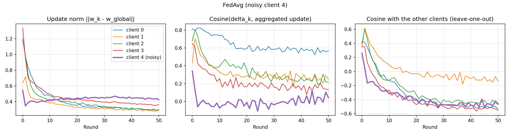

# FedAvg vs FedProx on PathMNIST with a noisy client

Screening task (Step 2, Part B) for the IndiaAI Fellowship 2026-27 project on LLM agents and federated learning (Dr Sachin D N, IIIT Bhopal).

* W&B project (public): https://wandb.ai/vaibhavsharma15-iiit-allahabad/fl-pathmnist-screening
* Built on PFLlib (https://github.com/TsingZ0/PFLlib); its original README is in `README_PFLlib.md`.

## Setup

* Dataset: PathMNIST (MedMNIST v2), 28x28 RGB, 9 tissue classes, 107,180 images.
* 5 clients, non-IID Dirichlet label split with alpha = 0.3 (PFLlib `separate_data`, partition seed 1).
* Each client's data is split 75% train / 25% test (PFLlib default). The official train, val and test splits are merged before partitioning, as in PFLlib's MNIST template.
* Client 4 has 40% symmetric label noise on its training data only (each flipped label moves to one of the 8 other classes; fixed noise seed; measured noisy fraction 0.4000). Test labels are clean.
* Model: PFLlib `FedAvgCNN` with 3 input channels (dim = 1024 for 28x28 inputs).
* Training: 50 rounds, all 5 clients every round, 1 local epoch, batch size 64, learning rate 0.01, training seed 0. PFLlib defaults are batch 10 and lr 0.005; I changed them for compute time and kept them identical for every run.
* Hardware: Kaggle, 2 x Tesla T4.

### Client data (after the Dirichlet split)

| Client | Samples | Train / Test | Main classes (count) |
|---|---|---|---|
| 0 | 35,666 | 26,749 / 8,917 | 8 (15,334), 5 (10,999), 7 (5,833) |
| 1 | 12,939 | 9,704 / 3,235 | 4 (6,867), 1 (2,267), 5 (2,131) |
| 2 | 24,252 | 18,189 / 6,063 | 6 (9,055), 0 (8,059), 7 (4,526) |
| 3 | 21,473 | 16,104 / 5,369 | 2 (11,243), 1 (7,497), 4 (2,718); only 4 classes |
| 4 (noisy) | 12,850 | 9,637 / 3,213 | 3 (11,279), 0 (1,162) |

## What I changed

| File | Change |
|---|---|
| `dataset/generate_PathMNIST.py` | New. Created from PFLlib's `generate_MNIST.py` template; loads PathMNIST with the `medmnist` package, 3 channels, 9 classes, 5 clients. |
| `dataset/utils/dataset_utils.py` | `alpha = 0.1` changed to `alpha = 0.3`. |
| `system/main.py` | PathMNIST CNN branch (3 input channels) placed before the `"MNIST"` check; new flags `-seed`, `-nid` (noisy client id), `-nr` (noise rate), `-wp` (W&B project), `-rn` (run name); seeding from `-seed`; `wandb.init` and `wandb.finish`. |
| `system/utils/data_utils.py` | New `add_label_noise()` (symmetric noise, fixed seed, returns the measured flipped fraction). |
| `system/flcore/clients/clientbase.py` | Applies noise in `load_train_data()` for client `-nid` only; client seed from `-seed`. |
| `system/flcore/servers/serverbase.py` | `evaluate()` logs global and per-client accuracy and loss every round to W&B and CSV; new `log_row()` and `update_stats()` (bonus). |
| `system/flcore/servers/serveravg.py`, `serverprox.py` | One line: `self.update_stats(i)` before `aggregate_parameters()`. |
| `plot_results.py` | New. Plots and results table from the CSV logs. |

Bonus metrics (computed in `update_stats()` before aggregation): for each client, delta_k = w_k minus w_global; update norm ||delta_k||; aggregated update delta = sum of (n_k / n) delta_k (the same weights FedAvg uses); cosine(delta_k, delta); and a leave-one-out cosine between delta_k and the weighted average of the other clients.

## How to reproduce

Extra packages: `medmnist wandb ujson h5py calmsize cvxpy`

    cd dataset && python generate_PathMNIST.py noniid - dir
    cd ../system
    COMMON="-data PathMNIST -m CNN -nc 5 -ncl 9 -gr 50 -ls 1 -lbs 64 -lr 0.01 -nid 4 -nr 0.4 -seed 0 -wp fl-pathmnist-screening"
    python main.py $COMMON -algo FedAvg -rn fedavg_seed0 -go fedavg_seed0
    python main.py $COMMON -algo FedProx -mu 0.01 -rn fedprox_mu0.01_seed0 -go fedprox_mu0.01_seed0
    python main.py $COMMON -algo FedProx -mu 0.1 -rn fedprox_mu0.1_seed0 -go fedprox_mu0.1_seed0
    python main.py $COMMON -algo FedAvg -nr 0 -rn fedavg_clean_seed0 -go fedavg_clean_seed0
    cd .. && python plot_results.py

Logs: `system/logs/<run>_eval.csv` and `<run>_stats.csv`.

## Results (mean of the last 5 rounds)

| Run | Global acc | Best | Client 0 | Client 1 | Client 2 | Client 3 | Client 4 |
|---|---|---|---|---|---|---|---|
| FedAvg (client 4 noisy) | 0.642 | 0.653 | 0.707 | 0.680 | 0.752 | 0.450 | 0.539 |
| FedProx mu=0.01 | 0.641 | 0.651 | 0.709 | 0.681 | 0.745 | 0.449 | 0.536 |
| FedProx mu=0.1 | 0.627 | 0.641 | 0.716 | 0.670 | 0.722 | 0.435 | 0.480 |
| FedAvg (no noise, control) | 0.657 | 0.667 | 0.663 | 0.689 | 0.767 | 0.474 | 0.706 |

Global accuracy is the global model's accuracy pooled over all clients' local test splits; client accuracy is the global model on that client's test split.

Bonus metrics, averaged over rounds:

| Run | Client 4 norm / mean of others | Client 4 leave-one-out cosine | Others' leave-one-out cosine |
|---|---|---|---|
| FedAvg (noisy) | 1.07 | -0.37 | -0.24 |
| FedAvg (no noise) | 0.74 | -0.13 | -0.21 |

## Observations (single seed)

* Label noise mainly hurts the noisy client itself: client 4 accuracy is 0.706 without noise and 0.539 with noise under FedAvg, while the other clients change by about 1 to 2 points. Global accuracy (0.657 vs 0.642) hides most of this.
* Client 4 stays near 0.1 accuracy for about 25 rounds before improving. It holds about 92% of all class-3 images, and only about 12% of the FedAvg weight, so the global model learns its main class slowly.
* FedProx with mu = 0.01 behaves like FedAvg. With mu = 0.1, global accuracy is lower (0.627) and client 4 drops further (0.480): the proximal term limits client drift but does not remove label noise, and it also slows the noisy client's adaptation to its own class mix.
* Update norms of clean clients shrink over training, while the noisy client's norm stays roughly flat; its norm relative to the others is 1.07 with noise vs 0.74 without.
* Client 4's cosine with the aggregated update stays near 0 while clean clients are at 0.15 to 0.6. This cosine is partly driven by client weight (the largest client, client 0, has the highest cosine). With the leave-one-out cosine, client 4 is lowest early in training, but after about 20 rounds all clients are negative (about -0.4), because under alpha = 0.3 clean clients also disagree with each other. Norms and cosines are useful signals for detecting a noisy client, but strong non-IID data confounds them, so a fixed threshold would not be enough.

## Limitations

* One training seed per setting; differences of 1 to 2 points may not be significant.
* 50 rounds; accuracy is still rising, so no run has converged.
* Batch size 64 and lr 0.01 instead of PFLlib defaults (same for all runs).
* The official PathMNIST test set (from a different clinical centre) is merged into the client splits, so results measure accuracy on each client's own data distribution, not on an unseen hospital.
